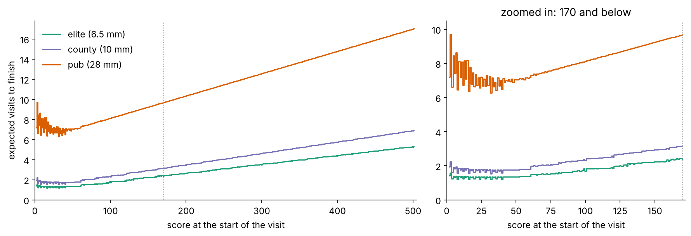
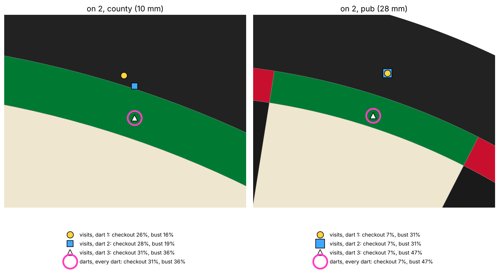
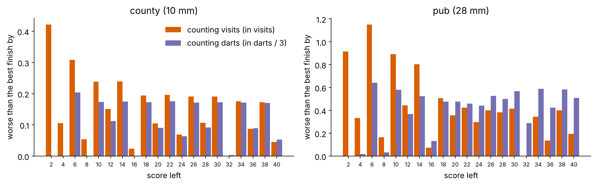
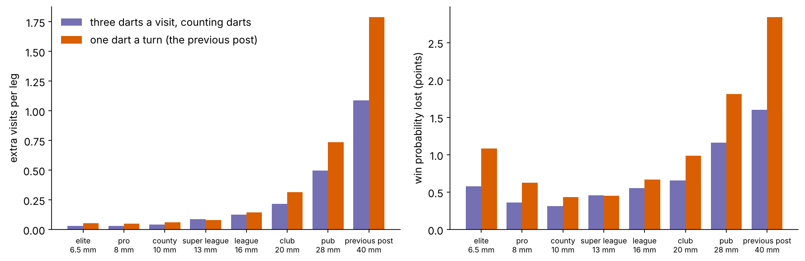
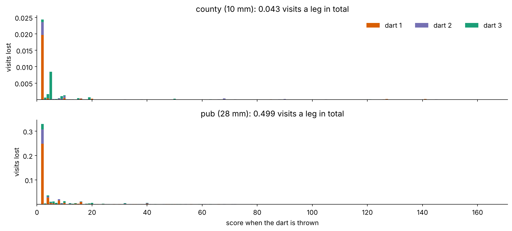



## What the last post got wrong

In the [previous post]() we used value iteration to find where Alice should aim from every score in a game of $501$. It produced sensible-looking advice: aim at the double when you are on an even number below $40$, leave yourself a power of two when you are not, and pile into the treble $19$ or treble $20$ when you are a long way out.

But to make that calculation easy, it quietly played a different game from the one in the pub. It treated every dart as a turn of its own, and it counted the cost of a leg in darts. Real $501$ differs on both counts:

1. **A turn (a "visit") is three darts, and a bust costs the whole visit.** If Alice busts, her score goes back to what it was *at the start of the visit*, not to what it was before that dart, and any darts she has left in her hand are forfeited.
2. **A race is measured in visits.** Alice's opponent, Bob, gets to throw after every three of her darts, not after every one. Finishing in $16$ darts or in $18$ darts is the same six visits, and Bob gets the same number of chances to beat her either way.

This post fixes both. The punchline, in brief: for a good player, the old advice was nearly right, and costs a few hundredths of a visit per leg. For a weak player it is worth more than half the advantage of throwing first. Almost all of the difference comes from one place on the board, which darts players have had a name for all along.

## Three darts, one visit

The fix is to give the Markov decision process more memory. A state now needs three numbers:

| | Previous post | This post |
| -------- | ------- | --- |
| States | the score left, $u$ | the score left $u$, which dart of the visit is in Alice's hand $d\in\lbrace 1,2,3\rbrace$, and the score the visit started on, $s$ |
| Actions | a point on the board to aim at | the same |
| Transitions | a bust returns to $u$ | a bust returns to $s$ and ends the visit; so does the third dart |
| Cost | $1$ per dart | $1$ per **visit** (or per dart, for comparison) |

Writing $V(u, d, s)$ for the expected cost of finishing from a state, the optimal Bellman equation becomes:

$$
V(u, d, s) = \min_{a\in\mathcal{A}}\left[c_d + \sum_{t\in\Omega,\ t \le u-2} p^a_t\, V^{+}(u-t) + b^a_u\, V(s, 1, s)\right]
$$

where

- $p^{a}_{t}$ is, as before, the probability of scoring $t$ when aiming at point $a$ (a miss is just $t = 0$, which leaves the score where it is),
- $V^{+}(u') = V(u', d+1, s)$ if Alice still has darts in hand, and $V(u', 1, u')$, a fresh visit, after the third dart,
- $b^a_u = 1 - \sum_{t\le u-2}p^a_t - dp^a_u$ is the probability of busting: scoring too much, leaving $1$, or hitting exactly $u$ on something other than a double,
- a checkout (probability $dp^a_u$) costs nothing more, so it does not appear,
- $c_d$ is the cost of the dart. To count darts, $c_d = 1$ every time; to count visits, $c_1 = 1$ and $c_2 = c_3 = 0$.

(I've switched from the previous post's negative rewards to positive costs, so it's a $\min$ rather than a $\max$; the two are the same thing.)

### It looks big, but it isn't

Naively that is a lot of states: about $80{,}000$ reachable combinations of $(u, d, s)$, each needing a maximum over the $\sim 30{,}000$ aiming points I use. But the board has a property that does most of the work: **the most a single dart can score is $60$, so a dart thrown from $62$ or more can never bust.** That means:

- on the third dart, the visit's starting score only matters below $62$, because above that nothing can send Alice back to it;
- on the second dart, it only matters below $122$;
- for the visit as a whole, only below $182$.

So only around $15{,}000$ states actually depend on where the visit started, and they are all in the low-score corner of the game. The one remaining loop is within a visit: a bust returns Alice to $V(s, 1, s)$, the value of the very visit being solved. That's a single number, and it can be found by fixed-point iteration. The whole game then solves in about ten seconds per player.

## How many visits from every score

Here is the result: the expected number of visits Alice needs to finish, from every score, for three standards of player. I'll use the same ability bands throughout. Each one is a throwing standard deviation $\sigma$, and its name says roughly what standard of player that is. A $10$mm thrower ("county") averages about $76$ per visit, and a $28$mm thrower ("pub") about $32$.

|  |
|:--:|
| Expected visits to finish, by the score at the start of the visit. The dotted line is $170$, the highest score that can be finished in one visit. |

The county player needs $6.90$ visits from $501$. Above about $100$ the curve is close to a straight line, because the advice there is the same as in the first post in this series: score as heavily as you can. Below that it flattens into the familiar finishing region. Here the pub player's curve does something odd: it gets *worse* as the score gets smaller. A pub player on $40$ expects to need $6.5$ more visits; on $2$, it's $7.2$. Hold that thought.

## Triple is funny, but the double depends on the dart

The new state has something the old one didn't: it knows how many darts Alice has left in her hand, so the advice can change from one dart of a visit to the next. Here is what it says when Alice is on $2$, the double $1$, at the start of a visit:

|  |
|:--:|
| Where to aim on 2 at the start of a visit. Filled markers: the optimal aim when counting visits, for each dart of the visit. Pink ring: the optimal aim when counting darts, which is the same for every dart. For the pub player, darts 1 and 2 share a point. |

When counting darts, the advice is the same for every dart: aim at the middle of the double $1$, which gives the best chance of finishing with that dart. When counting visits, the first dart goes **outside the double**, and the aim creeps inwards as Alice runs out of darts. It reaches the middle of the bed only for the third.

The reason is the difference between a miss and a bust. If Alice's dart goes over the top of the board, she scores nothing, but she is still on $2$ and still has darts in her hand. If it lands in the single $1$, she has busted: she is back on $2$, but her visit is over. With darts still to come, a miss is much better than a bust, so it's worth aiming a little high and giving up some checkout chance to turn busts into misses. For the county player, the first dart gives up $4.6$ points of checkout probability ($30.7\% \to 26.1\%$) and in exchange cuts the chance of busting by more than half ($35.7\% \to 16.3\%$). With the last dart, a miss and a bust both end the visit on $2$, so there is nothing to protect any more, and Alice should simply aim wherever she is most likely to finish.

Why can't the darts-counting model see this? Because of an accounting quirk. When Alice busts on her first dart, she forfeits the other two, and **a forfeited dart is never thrown, so it is never counted.** Measured in darts, a first-dart bust costs exactly as much as a miss: one dart, followed by another attempt from $2$. Measured in visits, it costs a whole visit. Counting darts makes busting look free.

## Welcome to the madhouse

Darts players call the double $1$ "the madhouse", because it's a miserable place to be stuck. The old model didn't agree. Counting visits does:

|  |
|:--:|
| How much worse each even finish is than the best one, for a county and a pub player. Orange: counting visits. Purple: counting darts, divided by three so that the bars are roughly comparable. |

For the county player, counting visits makes $2$ the **worst** even finish of all: $0.42$ visits worse than $32$, and $0.32$ visits worse than $4$. Counting darts, $2$ is the best finish on the board, marginally ahead of $4$. The pub player tells the same story: counting darts, $2$ is again the best even finish; counting visits, it is $0.92$ visits behind $32$ and $0.58$ behind $4$, and only $6$ is worse.

The reason is the same as above. On $4$, Alice aims at the double $2$, and the likeliest miss (a single $2$) leaves her on the double $1$ *with darts still in her hand*. On $2$, the likeliest miss (a single $1$) is a bust that ends the visit. Every finish has a fallback except the madhouse. The finishes darts players prize, $32$, $16$ and $8$, all halve into another double when the single is hit by mistake, and they come out well under both objectives.

### Busting on purpose

The value of $4$ over $2$ produces the strangest piece of advice in the model. Suppose a pub player started the visit on $4$ and has already hit a single $2$, so they are now on $2$ with one dart left. Busting now isn't a disaster: it sends them back to $4$, which is worth $0.58$ visits more than staying on $2$. The model's advice is to **aim at the single $1$**. It gives up a little checkout chance ($7.4\% \to 6.6\%$) to make a bust twice as likely as a miss ($64\%$ of darts bust). Busting deliberately is perfectly legal, and for this player it's correct.

## How much does all this matter?

To answer that properly, every policy needs to be played in the real game. So I built an exact evaluator: it takes any policy, plays it under the real rules (three darts a visit, busts back to the start of the visit), and computes its expected visits and darts from every score. As a check, it reproduces each solver's own value for its own policy to within $10^{-8}$.

Three policies are compared for each player:

- **optimal**: three darts a visit, counting visits;
- **counting darts**: three darts a visit, counting darts;
- **one dart a turn**: the previous post's policy, which only ever looks at the score.

|  |
|:--:|
| Left: extra visits per leg compared with the optimal policy. Right: the win probability lost against an opponent of the same standard who plays optimally. "Previous post" is the $40$mm player used there. |

| Player | $\sigma$ | Optimal visits | Extra visits: counting darts | Extra visits: one dart a turn | Win points lost: one dart a turn | Value of throwing first |
| --- | --- | --- | --- | --- | --- | --- |
| elite | 6.5mm | 5.32 | 0.030 | 0.053 | 1.1 | 16.2 |
| county | 10mm | 6.90 | 0.043 | 0.063 | 0.4 | 11.4 |
| league | 16mm | 10.19 | 0.124 | 0.145 | 0.7 | 6.7 |
| pub | 28mm | 17.02 | 0.499 | 0.736 | 1.8 | 3.2 |
| previous post | 40mm | 24.62 | 1.088 | 1.789 | 2.8 | 1.8 |

(The win probabilities treat a leg as a race between two players who ignore each other's score; an earlier experiment found that knowing the opponent's score is worth at most about $1.4$ points, and only below $120$.)

A few things stand out:

- **For good players, the old advice was nearly right.** A county player following the previous post loses $0.06$ visits a leg. It's real, but it would take a lot of legs to notice.
- **For weak players, it is not.** The pub player loses three quarters of a visit a leg, which is more than half of what throwing first is worth to them. The $40$mm player from the previous post loses $1.8$ visits a leg. That is worth more than throwing first.
- **The cost in win probability is U-shaped.** Elite players lose very few visits, but their legs are only five visits long, so each visit is worth a lot. The best players and the worst ones both have more to lose than the middle.
- **The optimal policy throws *more* darts.** The pub player's optimal policy needs $47.1$ darts a leg against the darts-counting policy's $46.5$, yet finishes half a visit sooner. It's happy to "waste" darts deliberately over the top of the board, because what it is saving is visits.
- **The old model's forecast was right, but its advice wasn't.** The previous post's model predicts $19.64$ darts for the county player; actually played under the real rules, its policy takes $19.69$. Its estimate of the cost was fine; it just didn't spend those darts in the right places.

### Where the visits go

Since the counting-darts policy is wrong somewhere, it's worth asking where. The cost of a policy can be split exactly into contributions from each state: how often the policy reaches the state, times how much its choice there costs compared with the optimal one. Here is that split for the counting-darts policy:

|  |
|:--:|
| Visits lost by the counting-darts policy, by the score when each dart is thrown and coloured by which dart of the visit it is. The bars add up to the total loss exactly. |

It's all in the finish. $95$–$98\%$ of the loss happens at scores of $40$ or less, and the madhouse alone accounts for $56\%$ of the county player's loss and $66\%$ of the pub player's, mostly on the first dart of a visit. That is exactly where a bust costs most. Everywhere above about $40$, the two objectives give nearly identical advice.

## What's next

So the advice for Alice is short:

- **Counting visits changes the finish, not the scoring.** Above $40$, nothing in this post matters.
- **With darts in hand, a miss is better than a bust**, so the first dart at a low double should be aimed a little outside it, and the last dart straight at the middle.
- **Avoid the madhouse.** It is the worst finish to be left on, and the further from a professional you are, the worse it is.

There are two simplifications still in here, and they'll each get a post of their own. The first is that Alice's throw is a round Gaussian. When I tested that against data from professional matches, a dart turned out to be much more heavy-tailed than a Gaussian, and that mostly moves exactly the part of the game this post is about: the finish. The second is that Alice ignores Bob. The race with an opponent can be solved exactly too; it turns out knowing his score is worth surprisingly little, but not nothing.

The code for everything in this post is in the [DartsStrats repository](https://github.com/mjc239/DartsStrats), in `notebooks/Posts/2026-11-count-visits-not-darts.ipynb`.
