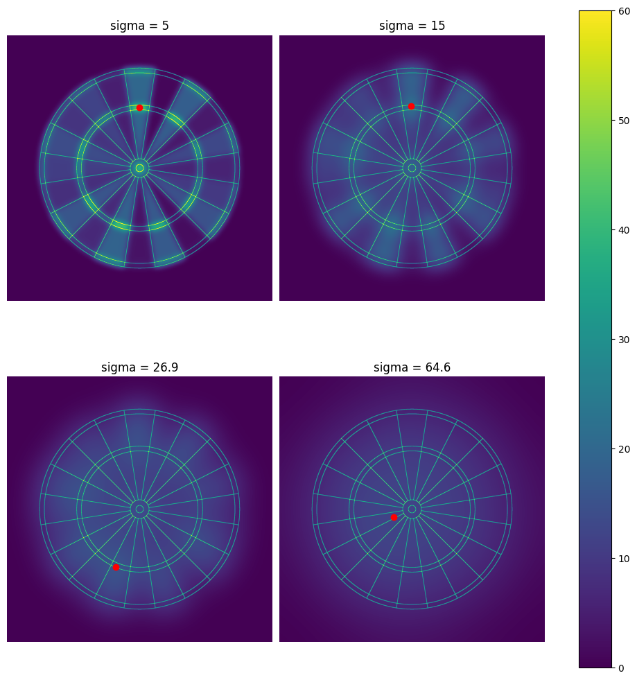

A collection of posts, using a statistical approach to analyse the game of darts - in particular, looking at:
- The best ways to maximise score and come up with winning strategies
- Analysing the Quadro board, a variant of the standard board used briefly in the 90s
- Constructing tools to help players optimise their game.

## Posts

🎯[Introduction + motivation](../_posts/2024-02-07-darts-frontpage.md) - why did the Quadro board flop?

🎯[How do I throw high scoring darts?](../_posts/2024-02-18-maximising-single-dart.md) - where should I aim on the board, to maximise my score?

🎯[How can I reach checkout before my opponent?](../_posts/2024-02-24-dart-sharpe-ratio.md) - maximising the probability of reaching checkout in N moves

🎯[How do I play on-player continuous 501 optimally?](../_posts/2024-11-20-continuous-dart-rl.md) - where to aim to minimise the number of darts until checkout

🎯[Count visits, not darts](../_posts/2026-11-04-count-visits-not-darts.md) - three darts a visit, busts that cost the whole visit, and why double 1 is the madhouse
