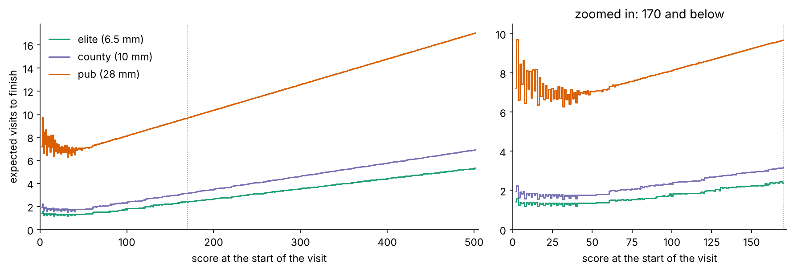
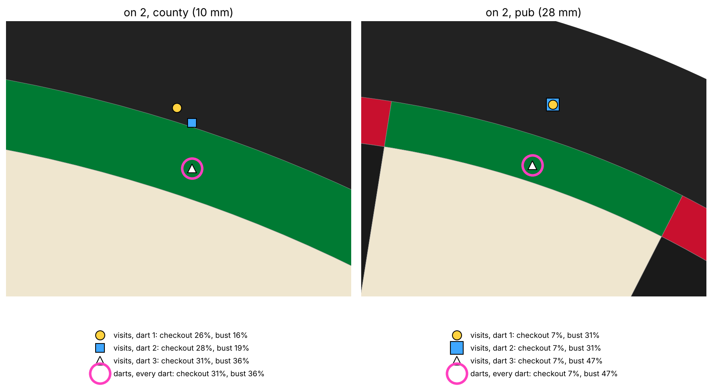
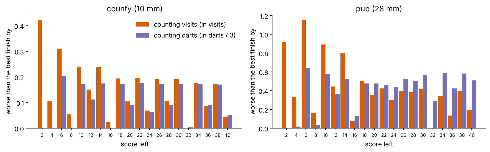
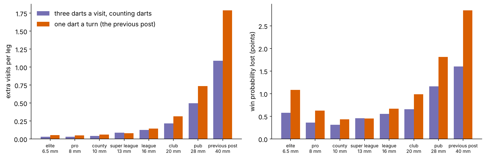
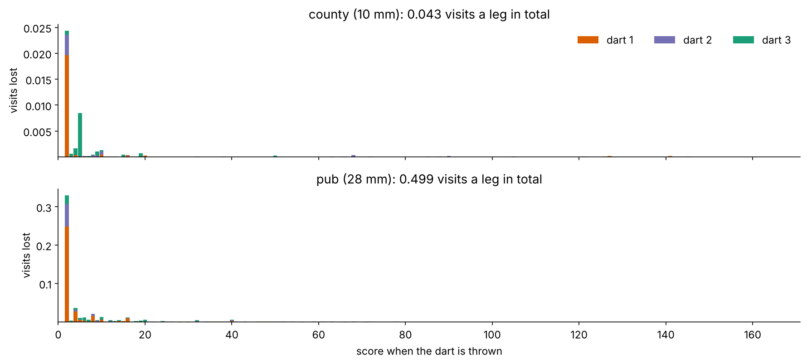



## What the last post got wrong

In the [previous post](), we used value iteration to find the optimal place for Alice to aim from every score in a game of $501$. The resulting strategy looked sensible: aim for the relevant double when on an even score below $40$, try to leave a power of two otherwise, and aim for the triple $19$ or triple $20$ when the remaining score is large.

But were we actually modelling the same game? To make the calculation easier, we made two simplifying assumptions. Each dart was treated as a separate turn, and the objective was to minimise the expected number of darts required to finish. In a real game of $501$:

1. A turn (or "visit") consists of three darts, and a bust ends the whole visit. Alice's score returns to its value at the start of the visit, rather than its value before the last dart, and she forfeits any remaining throws.
2. The race against an opponent is measured in visits. Bob gets a turn after every three of Alice's darts, rather than after each dart. Finishing in $16$ darts or in $18$ darts takes the same six visits, giving Bob the same number of opportunities to finish first.

How much do these assumptions affect the strategy? For a good player, the previous advice was close to optimal, costing only a few hundredths of a visit per leg. For a weak player, the cost is worth more than half the advantage of throwing first. Almost all of this difference comes from one part of the board, which already has a familiar name among darts players.

## Three darts, one visit

To model visits correctly, we need to include more information in the state of the Markov decision process. Each state now contains three numbers:

| | Previous post | This post |
| -------- | ------- | --- |
| States | the score left, $u$ | the score left $u$, which dart of the visit is in Alice's hand $d\in\lbrace 1,2,3\rbrace$, and the score the visit started on, $s$ |
| Actions | a point on the board to aim at | the same |
| Transitions | a bust returns to $u$ | a bust returns to $s$ and ends the visit; so does the third dart |
| Cost | $1$ per dart | $1$ per **visit** (or per dart, for comparison) |

Writing $V(u, d, s)$ for the expected cost of finishing from a particular state, the optimal Bellman equation is:

$$
V(u, d, s) = \min_{a\in\mathcal{A}}\left[c_d + \sum_{t\in\Omega,\ t \le u-2} p^a_t\, V^{+}(u-t) + b^a_u\, V(s, 1, s)\right]
$$

where

- $p^{a}_{t}$ is, as before, the probability of scoring $t$ when aiming at point $a$ (a miss corresponds to $t = 0$, leaving the score unchanged),
- $V^{+}(u') = V(u', d+1, s)$ if Alice has darts remaining, and $V(u', 1, u')$ after the third dart, when a new visit begins,
- $b^a_u = 1 - \sum_{t\le u-2}p^a_t - dp^a_u$ is the probability of busting: scoring too much, leaving $1$, or reaching exactly $u$ without hitting a double,
- a checkout (probability $dp^a_u$) has no further cost, so does not contribute to the expression,
- $c_d$ is the cost assigned to the dart. To count darts, $c_d = 1$ for every dart; to count visits, $c_1 = 1$ and $c_2 = c_3 = 0$.

(I've switched from the previous post's negative rewards to positive costs, so we now have a $\min$ rather than a $\max$. The two approaches are equivalent.)

### It looks big, but it isn't

At first, this looks like a lot more work: there are about $80{,}000$ reachable combinations of $(u, d, s)$, each requiring an optimisation over the $\sim 30{,}000$ possible aiming points. However, we can take advantage of a simple property of the board: the maximum score with a single dart is $60$, so a player on $62$ or more cannot bust with that dart. Therefore:

- on the third dart, the starting score of the visit only matters below $62$, as above this score a bust is impossible;
- on the second dart, it only matters below $122$;
- for the visit as a whole, it only matters below $182$.

This leaves around $15{,}000$ states whose values depend on the starting score of the visit, all at the lower end of the score range. There is one remaining loop to account for: a bust returns Alice to $V(s, 1, s)$, the value of the visit currently being evaluated. This is a single number which can be found using fixed-point iteration. The full calculation takes about ten seconds per player.

## How many visits from every score

Let's start by plotting the expected number of visits required to finish from each score, for three standards of player. Throughout this post, each ability band corresponds to a throwing standard deviation $\sigma$, with a name indicating roughly the standard of player it represents. A player with a standard deviation of $10$mm ("county") averages about $76$ per visit, while a $28$mm player ("pub") averages about $32$.

|  |
|:--:|
| Expected visits to finish, by the score at the start of the visit. The dotted line is $170$, the highest score that can be finished in one visit. |

The county player requires $6.90$ visits from $501$. Above about $100$, the value function is approximately linear: as in the first post in this series, the player is mainly trying to maximise the score of each dart. Below this, the curve flattens as checking out becomes more important. For the pub player, there is a less obvious result: the expected number of remaining visits can increase as the score decreases. From $40$, this player expects to need $6.5$ more visits; from $2$, this rises to $7.2$. Why should getting closer to zero make things worse? We'll return to this shortly.

## Triple is funny, but the double depends on the dart

The expanded state allows the optimal action to depend on how many darts Alice has remaining, as well as her score. How does this affect the recommended aiming point? Consider Alice starting a visit on $2$, requiring the double $1$:

|  |
|:--:|
| Where to aim on 2 at the start of a visit. Filled markers: the optimal aim when counting visits, for each dart of the visit. Pink ring: the optimal aim when counting darts, which is the same for every dart. For the pub player, darts 1 and 2 share a point. |

When minimising the expected number of darts, the recommendation is the same for every throw: aim at the centre of the double $1$, maximising the probability of checking out with that dart. When minimising visits, the first aiming point is outside the double. It moves inwards as the number of remaining darts decreases, reaching the centre of the region only on the third dart.

The reason is the distinction between missing and busting. A dart which goes over the top of the board scores nothing, but leaves Alice on $2$ with her remaining darts available. A dart which hits the single $1$ also leaves her on $2$, but ends the visit. With darts remaining, a miss is therefore preferable to a bust. Aiming slightly higher sacrifices some checkout probability in exchange for a lower probability of busting. For the county player, this reduces the first-dart checkout probability by $4.6$ points ($30.7\% \to 26.1\%$), while more than halving the bust probability ($35.7\% \to 16.3\%$). On the final dart, both a miss and a bust end the visit on $2$, so the optimal action is simply to maximise the probability of finishing.

Why does minimising darts fail to capture this distinction? When Alice busts with her first dart, she forfeits the remaining darts, but these are never thrown and therefore never counted. In terms of darts thrown, a first-dart bust has the same cost as a miss: one dart, followed by another attempt from $2$. In terms of visits, it ends the whole turn. Counting darts effectively assigns no cost to the forfeited throws.

## Welcome to the madhouse

Darts players call the double $1$ "the madhouse", and anyone who's been stuck there can probably see why. The old model didn't capture this, but what happens when we count visits?

|  |
|:--:|
| How much worse each even finish is than the best one, for a county and a pub player. Orange: counting visits. Purple: counting darts, divided by three so that the bars are roughly comparable. |

For the county player, $2$ is the worst even finish when counting visits: it is $0.42$ visits worse than $32$, and $0.32$ visits worse than $4$. When counting darts, however, $2$ is the best finish on the board, slightly ahead of $4$. The pub player shows a similar pattern. Counting darts, $2$ is again the best even finish; counting visits, it is $0.92$ visits worse than $32$ and $0.58$ worse than $4$, with only $6$ performing worse.

Again, this follows from what happens after a missed double. On $4$, Alice aims for double $2$, and the most likely miss is a single $2$, leaving double $1$ with darts still available. On $2$, the corresponding miss into single $1$ ends the visit. Every finish has a fallback except the madhouse. The familiar preferred finishes, $32$, $16$ and $8$, all leave another double when the single is hit instead, and perform well under both objectives.

### Busting on purpose

The difference in value between $4$ and $2$ leads to a particularly unusual recommendation. Suppose the pub player starts a visit on $4$, hits a single $2$, and is now on $2$ with one dart remaining. A bust returns the player to $4$, which is worth $0.58$ visits more than remaining on $2$. The optimal action is to aim at the single $1$. This slightly reduces the checkout probability ($7.4\% \to 6.6\%$), but makes a bust twice as likely as a miss ($64\%$ of darts bust). Deliberately busting is perfectly legal, and for this player it's actually the best strategy.

## How much does all this matter?

To compare the policies, we need to evaluate all of them under the same rules. I implemented an exact evaluator which takes a policy and computes the expected visits and darts required from every score, using three-dart visits and returning busts to the starting score of the visit. As a check, it reproduces the value calculated by each policy's own solver to within $10^{-8}$.

For each player, we compare three policies:

- **optimal**: three darts per visit, minimising visits;
- **counting darts**: three darts per visit, minimising darts;
- **one dart a turn**: the policy from the previous post, which depends only on the current score.

|  |
|:--:|
| Left: extra visits per leg compared with the optimal policy. Right: the win probability lost against an opponent of the same standard who plays optimally. "Previous post" is the $40$mm player used there. |

| Player | $\sigma$ | Optimal visits | Extra visits: counting darts | Extra visits: one dart a turn | Win points lost: one dart a turn | Value of throwing first |
| --- | --- | --- | --- | --- | --- | --- |
| elite | 6.5mm | 5.32 | 0.030 | 0.053 | 1.1 | 16.2 |
| county | 10mm | 6.90 | 0.043 | 0.063 | 0.4 | 11.4 |
| league | 16mm | 10.19 | 0.124 | 0.145 | 0.7 | 6.7 |
| pub | 28mm | 17.02 | 0.499 | 0.736 | 1.8 | 3.2 |
| previous post | 40mm | 24.62 | 1.088 | 1.789 | 2.8 | 1.8 |

The win probabilities model a leg as a race between players who ignore their opponent's score. An earlier experiment found that accounting for the opponent's score is worth at most about $1.4$ points, and only below $120$.

There are several interesting observations:

- For strong players, the previous strategy is close to optimal. The county player loses $0.06$ visits per leg by following the previous post's policy, a difference which would take many legs to become apparent.
- For weaker players, the difference is more substantial. The pub player loses three quarters of a visit per leg, worth more than half the advantage of throwing first. The $40$mm player from the previous post loses $1.8$ visits per leg, which is worth more than throwing first.
- The reduction in win probability is U-shaped. Elite players lose very few visits, but their legs last only five visits, making each visit more valuable. Both the strongest and weakest players therefore lose more than those in the middle.
- The optimal policy uses more darts. The pub player requires $47.1$ darts per leg under the optimal policy, compared with $46.5$ when minimising darts, but finishes half a visit sooner. It is worth "wasting" darts over the top of the board to preserve the remaining throws in a visit.
- The previous model estimated the number of darts accurately, despite recommending a suboptimal strategy. For the county player, it predicts $19.64$ darts; evaluated under the real rules, its policy requires $19.69$. The estimate was close, but the darts were not being used in the best places.

### Where the visits go

So where does the counting-darts policy lose these visits? We can split the total cost exactly into contributions from each state: how often the player reaches it, multiplied by how much the chosen action costs compared with the optimal one. Let's plot those contributions:

|  |
|:--:|
| Visits lost by the counting-darts policy, by the score when each dart is thrown and coloured by which dart of the visit it is. The bars add up to the total loss exactly. |

Almost all of the difference occurs when checking out. Scores of $40$ or less account for $95$–$98\%$ of the loss, while the madhouse alone contributes $56\%$ for the county player and $66\%$ for the pub player. Most of this occurs on the first dart of a visit, when busting forfeits the most remaining darts. Above about $40$, the two objectives recommend almost identical strategies.

## What's next

What can we conclude about Alice's strategy?

- Counting visits changes the checkout strategy, rather than the scoring strategy. Above $40$, the changes considered in this post do not affect the advice.
- With darts remaining, a miss is preferable to a bust. On a low double, the first aiming point should therefore be slightly outside the double, moving to the centre for the final dart.
- Avoid the madhouse. It is the worst finish to leave, and becomes more costly as the player's ability decreases.

Of course, there are still two simplifying assumptions we haven't tested here. I'll look at each in a future post. The first is the spherically symmetric Gaussian throwing distribution. Testing this assumption against data from professional matches showed a much more heavy-tailed distribution, with the main effect occurring in the checkout region studied here. The second is that Alice ignores Bob's score. It is also possible to solve the race against an opponent exactly; knowing his score turns out to be worth surprisingly little, but the effect is not zero.

The code for this post is available in the [DartsStrats repository](https://github.com/mjc239/DartsStrats), in `notebooks/Posts/2026-11-count-visits-not-darts.ipynb`.
